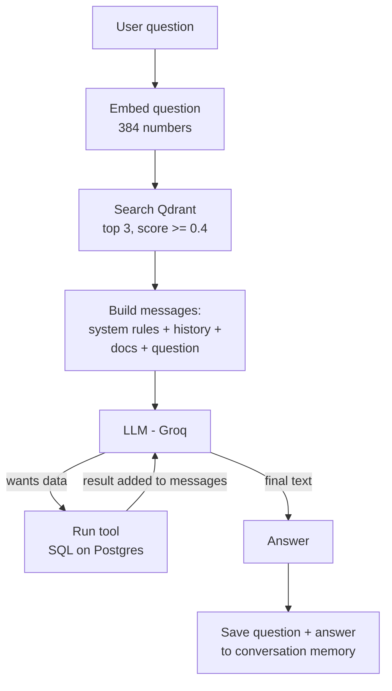

# RAG Support Assistant for a Mutual-Fund App

A learning project: a chat assistant that answers a customer's questions about their
SIPs and orders. It combines two techniques:

- **Tool calling**: for questions about *the user's own data* ("what is my latest SIP?"),
  the LLM calls functions that query Postgres.
- **RAG (Retrieval-Augmented Generation)**: for questions about *company policy*
  ("how long can I pause my SIP?"), the app searches policy documents stored in a
  vector database and gives the matching passages to the LLM.

The assistant is **grounded**: it may only answer from those two sources. If neither
covers a question, it says it doesn't have that information instead of using the
LLM's general knowledge.

---

## How a question is answered



Step by step, for `POST /chat`:

1. **Retrieve**: the question is turned into an embedding and Qdrant returns the most
   similar policy chunks (at most 3, and only if they score at least 0.4).
2. **Augment**: the chunks are attached to the question as clearly labelled reference
   material. If nothing matched, the message says so explicitly.
3. **Generate**: the LLM gets the system rules, the conversation so far, and the
   augmented question, together with the list of available tools.
4. **Tool loop**: if the LLM asks for a tool, the server runs it, adds the result to the
   messages and calls the LLM again (at most 5 rounds).
5. **Remember**: only the plain question and the final answer are saved for the next turn.

---

## Tech stack

| Part | What we use |
|---|---|
| Server | Node.js 18, Express 5 |
| Database | PostgreSQL (`pg`) - database `rag`, table `orders` |
| LLM | Groq, model `openai/gpt-oss-120b`, via the OpenAI-compatible `/chat/completions` API |
| Vector database | Qdrant 1.19 (local binary, no Docker), `@qdrant/js-client-rest` |
| Chunking | `@langchain/textsplitters` (markdown splitter) |
| Embeddings | `Xenova/all-MiniLM-L6-v2` running locally via `@huggingface/transformers` - 384 dimensions, no API key |
| Config | `dotenv` (`.env` file) |

## Files

| File | Purpose |
|---|---|
| `server.js` | Express app: the SQL tools, tool registry, chat loop, memory and RAG retrieval |
| `llm.js` | LLM client - one `callLLM(messages, tools)` function |
| `chunk.js` | Splits `knowledge/*.md` into chunks |
| `embed.js` | `embed(text)` - turns text into a 384-number vector |
| `qdrant.js` | Qdrant client and the collection name |
| `ingest.js` | Chunk -> embedding -> stored in Qdrant |
| `search.js` | Question -> most similar chunks from Qdrant |
| `knowledge/` | The policy documents the assistant answers from |

---

## The logic in detail

### 1. Tools (questions about the user's data)

Each tool is a plain async function running one parameterised SQL query (`$1`, `$2`;
never string concatenation):

| Tool | Answers |
|---|---|
| `getLatestSip` | latest `purchase_sip` order: status, amount, frequency, next debit |
| `getLatestPausedSip` | latest `pause_sip` order, its `pause_till_date` and `is_pause_active` |
| `listOrders` | recent orders, optionally filtered by status |
| `getSipSummary` | total amount and order count per order type (paid orders only) |

A **registry** describes each tool to the LLM with a `description` and a JSON Schema of
its `parameters`. The LLM reads the descriptions to decide which tool fits a question.

Key decisions:

- **The LLM never chooses the `userId`.** It isn't a tool parameter; the server passes
  it in. So a user can't talk the model into fetching another user's orders.
- **Postgres decides whether a pause is active**, with `pause_till_date >= current_date`.
  LLMs don't reliably know today's date, and the `status` column alone isn't updated
  when a pause ends.
- **Dates are returned as text** (`to_char(...)`), because the `pg` driver otherwise
  converts them to UTC timestamps and they appear a day early.
- Tool errors are handed back to the LLM as `{ error }` instead of crashing the request.

### 2. Conversation memory

LLM APIs are stateless: every call must include the whole conversation. The server keeps
each conversation in memory, keyed by `conversationId`, and resends it on each turn.

- Only the **plain question and the final answer** are saved. Tool calls, tool results and
  retrieved docs are used for one turn and then dropped, which keeps the history small.
  A follow-up simply calls the tool or searches again and gets fresh data.
- The last **20 messages** are kept per conversation.
- A turn is saved only after the LLM call succeeds, so a failed call leaves no
  unanswered question behind.
- Memory lives in a JavaScript `Map`, so **restarting the server clears it**.

### 3. RAG ingestion (done once, and again whenever the docs change)

```
knowledge/*.md  ->  chunk.js  ->  embed.js  ->  Qdrant
```

**Chunking** (`chunk.js`): LangChain's markdown splitter cuts each document into pieces
of at most **150 characters**, preferring to cut at headings, then blank lines, then line
ends, then spaces.

- **Overlap of 80 characters**: when a long section must be cut, the next piece repeats the
  previous piece's last line, so a sentence cut in half is still complete in one chunk.
  It must be larger than one line (~75 characters), because the splitter only repeats
  whole pieces.
- **Section labels**: the splitter doesn't understand headings, so a piece cut from the
  middle of a section would lose its context. Using the line numbers the splitter
  reports, each chunk is prefixed with `Document title > Section`, e.g.
  `Order Status Guide > failed`.

**Embedding** (`embed.js`): each chunk becomes 384 numbers that represent its meaning.
Vectors are mean-pooled and normalised, so comparing two vectors measures only how
similar their meaning is. Texts with similar meaning get similar vectors even when they
use different words.

**Storing** (`ingest.js`): each chunk becomes a Qdrant *point* in the collection
`knowledge_mutual_funds` (cosine distance, size 384) with:
- `vector`: the embedding, used for searching
- `payload`: the chunk text plus its file, section and line numbers

Point IDs are derived from the chunk ID (an MD5 hash formatted as a UUID), so storing the
same chunk again overwrites it instead of duplicating it. `node ingest.js` deletes and
rebuilds the collection, so chunks removed from a document don't linger.

### 4. RAG retrieval (on every chat message)

The question is embedded with the **same model** and Qdrant returns the closest chunks.

- **Top 3** chunks per question.
- **Minimum score 0.4** (1 = same meaning, 0 = unrelated). Measured on these docs:
  greetings and off-topic questions score 0.06-0.18 and policy questions 0.56-0.79, so 0.4
  separates them. Questions about the user's own data ("what is my latest SIP?") score
  around 0.5 because they share words with the docs, so they can get a harmless extra
  chunk. No single cut-off separates those.
- If Qdrant is unreachable, chat still works, just without documents.

The chunks are attached to the question like this:

```
Reference from our policy documents:
[1] SIP Pause Policy > Duration: A SIP can be paused for one to three instalments.
[2] SIP Pause Policy > Cutoff: A pause request must be submitted at least five ...

Question: How long can I pause my SIP?
```

### 5. Grounding rules

The system prompt tells the LLM to answer **only** from the attached documents and tool
results, never from general knowledge, and never to describe app features those sources
don't mention. When no chunk matches, the message explicitly says
`none matched this question`. Without that, an empty search was silent and the model
answered from general knowledge (it once explained "SWP" and invented app features).

---

## Database

Database `rag`, table `orders`:

```sql
CREATE TABLE orders (
    id                 uuid PRIMARY KEY DEFAULT gen_random_uuid(),
    cart_id            uuid,
    status             text,          -- paid, failed, paused, pending
    txn_no             text,
    order_type         text,          -- purchase_sip, pause_sip, redeem
    created_at         timestamp DEFAULT now(),
    created_by         text,
    updated_at         timestamp DEFAULT now(),
    updated_by         text,
    user_id            uuid,
    expert_id          uuid,
    meta               jsonb,
    next_debit_date    text,          -- DD/MM/YYYY, kept as text like the source data
    external_order_no  text,
    start_date         text,          -- DD/MM/YYYY
    amount             numeric(14,2),
    frequency          text,          -- e.g. monthly
    pause_till_date    date           -- end of a pause, for pause_sip orders
);
```

---

## Running it

### Prerequisites

- Node.js 18+
- PostgreSQL with a database `rag` and the `orders` table above
- A free Groq API key from [console.groq.com/keys](https://console.groq.com/keys)

### 1. Configure

Create a `.env` file (it is git-ignored):

```
LLM_API_KEY=gsk_...
LLM_BASE_URL=https://api.groq.com/openai/v1
LLM_MODEL=openai/gpt-oss-120b
```

Any OpenAI-compatible provider works by changing these three values (see `llm.js`).

### 2. Install

```bash
npm install
```

### 3. Start Qdrant (no Docker)

The `qdrant/` folder is git-ignored. To set it up on an Apple Silicon Mac:

```bash
mkdir -p qdrant && cd qdrant
curl -L https://github.com/qdrant/qdrant/releases/download/v1.19.1/qdrant-aarch64-apple-darwin.tar.gz | tar -xz
# optional dashboard at http://localhost:6333/dashboard
curl -LO https://github.com/qdrant/qdrant-web-ui/releases/download/v0.2.18/dist-qdrant.zip
unzip dist-qdrant.zip && mv dist static && rm dist-qdrant.zip
```

Start it **from inside the `qdrant/` folder**, because it looks for `./storage` and
`./static` relative to where it is started:

```bash
cd qdrant && QDRANT__STORAGE__STORAGE_PATH=./storage ./qdrant
```

### 4. Load the documents into Qdrant

```bash
node ingest.js
```

Run this again whenever you change anything in `knowledge/`.
The first run downloads the embedding model (~23 MB).

### 5. Start the server

```bash
node server.js
```

### Handy commands

```bash
node chunk.js                      # print the chunks
node embed.js "some text"          # print a vector
node search.js "your question"     # print the best matching chunks
```

---

## API

| Method | Path | What it does |
|---|---|---|
| `POST` | `/chat` | Ask a question. Body: `userId`, `message`, optional `conversationId` |
| `GET` | `/chat/:conversationId` | Show what the conversation remembers |
| `DELETE` | `/chat/:conversationId` | Clear a conversation |
| `GET` | `/tools` | The tool definitions sent to the LLM |
| `POST` | `/tools/:name` | Run a tool directly (no LLM). Body: `userId`, plus tool arguments |

```bash
curl -X POST localhost:3000/chat -H 'content-type: application/json' \
  -d '{"userId":"5eb6cdb9-8192-411a-bff3-c5d630d33dce","conversationId":"c1","message":"How long can I pause my SIP?"}'
```

The response shows where the answer came from:

```json
{
  "reply": "A SIP can be paused for one to three instalments.",
  "sources": [
    { "source": "sip-pause-policy.md", "section": "Duration", "score": 0.787 },
    { "source": "sip-pause-policy.md", "section": "Cutoff", "score": 0.751 },
    { "source": "sip-pause-policy.md", "section": "Eligibility", "score": 0.72 }
  ],
  "toolsUsed": [],
  "conversationId": "c1"
}
```

---

## Known limitations

- **Follow-up questions**: retrieval embeds the question as typed, so "how long can I do
  it for?" has no keywords to match. Planned fix: make document search a tool, so the
  LLM writes the search query itself.
- **Memory is in RAM** and is lost on restart.
- **Small embedding model**: different wording with the same meaning scores lower
  ("stop my monthly investment" vs "pause my SIP").
- **Strict grounding**: general questions such as "what is a SIP?" get "I don't have that
  information" unless a document covers them. Add documents to `knowledge/` to expand
  what it can answer.
- **Pauses aren't linked to a specific SIP**: the `orders` table has no column connecting
  a `pause_sip` order to the `purchase_sip` it pauses.
- **Node 18 version pins**: `@huggingface/transformers` is pinned to 3.8.1 and
  `@langchain/textsplitters` resolves to 0.1.x, because newer versions need Node 20.
- The policy documents in `knowledge/` are sample content written for learning, not real
  rules.

## Next steps

- Turn document search into a tool (fixes follow-up questions, lets the model combine
  documents with order data)
- Store conversation memory in Postgres
- Link pause orders to the SIP they pause
